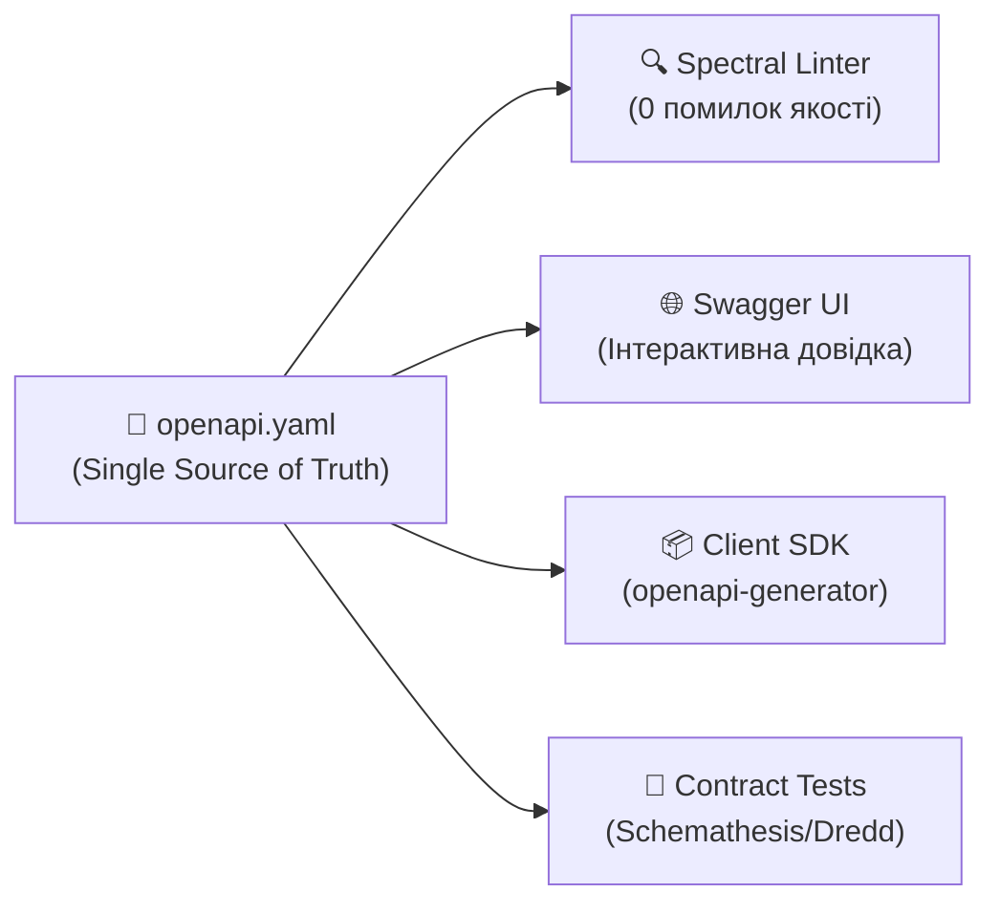

# Інтерфейси та контракти API: api/index.md

> **Цільова аудиторія:** Інженери інтеграції, Frontend-команда, QA-автоматизатори  
> **Методологія:** API-First & Single Source of Truth (SSOT)  
> **Теги:** #api #openapi #swagger #contracts  

---

## 1. Концепція Single Source of Truth (SSOT)

У системі `System-loyalty-customers-backend` специфікація API розробляється за підходом **API-First**:
- Єдиним першоджерелом істини є машинно-читний контракт **[openapi.yaml](openapi.yaml)** (OpenAPI Specification 3.0.3).
- Інтерактивна довідка Swagger UI та клієнтські бібліотеки SDK генеруються **безпосередньо з цього контракту**, унеможливлюючи розсинхронізацію коду та описів.



---

## 2. Базова інформація про сервіс

- **Base URL:** `http://localhost:3001/api/v1`
- **Протокол:** HTTP/1.1 (JSON over HTTP)
- **Автентифікація:** Bearer JWT Token у заголовку `Authorization: Bearer <token>`
- **Кореляційний ID:** Заголовок `x-correlation-id` для наскрізного трасування (Distributed Tracing)

---

## 3. Ключові групи маршрутів

| Група ресурсів | Маршрут | Опис |
| :--- | :--- | :--- |
| **Клієнти (Core)** | `/api/v1/customers` | Реєстрація нового клієнта, пошук за ID, підвищення рівня лояльності. |
| **Приватність (GDPR)** | `/api/v1/customers/{id}/personal-data` | Експорт персональних даних суб'єкта, право на забуття (анонімізація). |
| **Згоди (Consents)** | `/api/v1/customers/{id}/consents` | Надання, відкликання та ревізія згод на обробку персональних даних. |
| **Надійність (Health)** | `/health` | Liveness/Readiness зонди для Kubernetes та Consul. |
| **Chaos Engineering** | `/api/v1/fault-injection` | Керування ін'єкцією збоїв (HTTP 500, таймаути) для тестування стабільності. |

---

## 4. Інтерактивна консоль Swagger UI та Клієнтський SDK

### Онлайн Swagger UI
Переглянути інтерактивну специфікацію та виконати тестові виклики (Try It Out) через браузер можна за адресою:  
👉 **[http://localhost:3001/api-docs](http://localhost:3001/api-docs)**  
Контракт у форматі YAML доступний безпосередньо у репозиторії: **[openapi.yaml](openapi.yaml)**.

### Генерація та використання клієнтського SDK (`sdk-client/`)
Клієнтський TypeScript SDK скомпільовано на основі контракту:
```typescript
import { SystemLoyaltyClient } from '../sdk-client/index.js';

const client = new SystemLoyaltyClient({ baseUrl: 'http://localhost:3001' });

// 1. Реєстрація клієнта
const customer = await client.registerCustomer({
    name: 'Олександр Шевченко',
    email: 'alex.shevchenko@example.com',
    phone: '+380671234567'
});

// 2. GDPR експорт персональних даних
const exportData = await client.exportPersonalData(customer.id, customer.id);
console.log('GDPR Article 15 Export:', exportData.profile.tier);
```

### Верифікація якості контракту (Spectral Linter)
```bash
npx spectral lint docs/api/openapi.yaml
# Вердикт: 0 errors (PASS)
```

> Пов'язані документи (Obsidian Graph): [[sdd]] | [[isd]] | [[CONTRIBUTING]] | [[ADR-0001-nodejs-typescript]]
