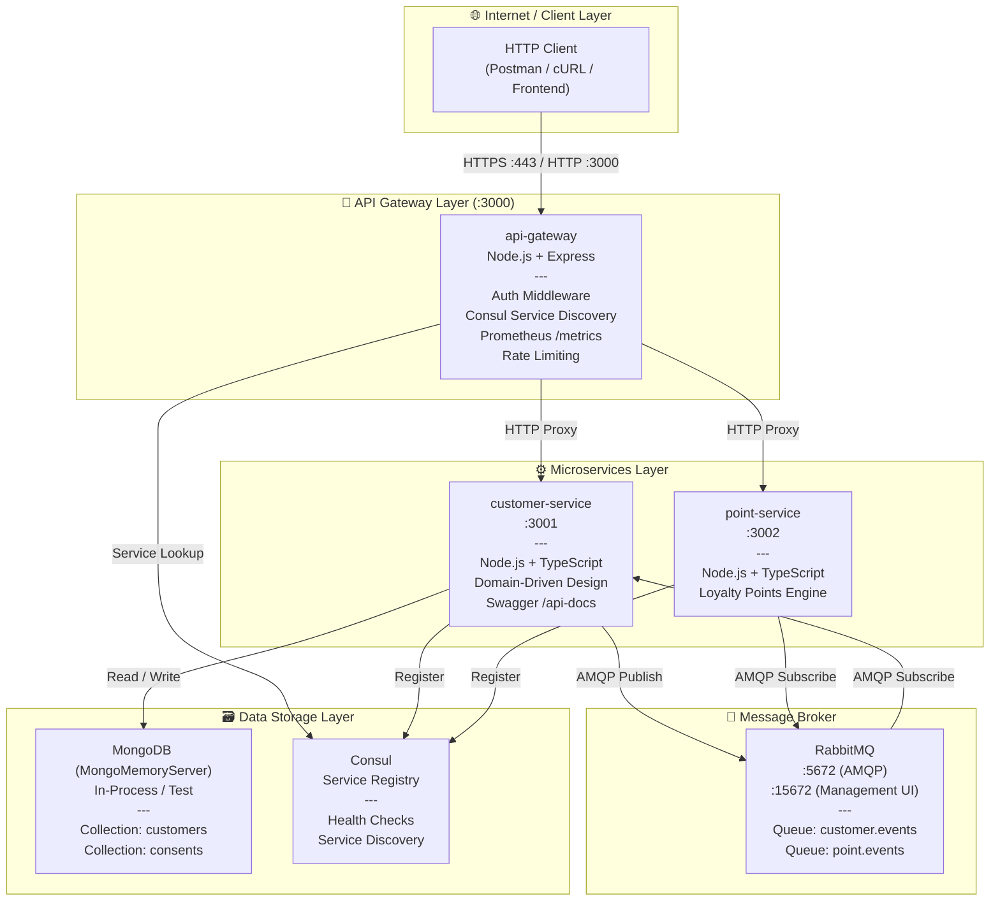
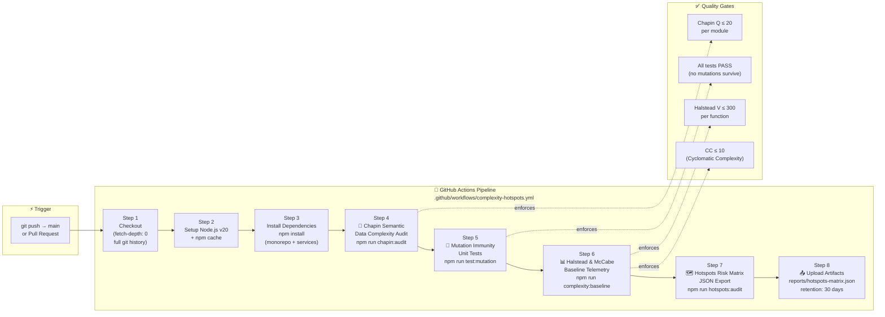

# Infrastructure Specification Document (ISD)
## System-loyalty-customers-backend

> **Версія:** 1.0.0  
> **Дата:** 2026-11-16  
> **Статус:** Active  
> **Розробник:** Horizon-55  
> **Останнє оновлення:** Лабораторна робота №10 — Documentation Engineering  

---

## 1. Мережева Топологія



---

## 2. Середовища (Environments)

| Параметр | Development | Test (CI) | Production (Target) |
| :--- | :---: | :---: | :---: |
| **Platform** | Windows / macOS local | GitHub Actions (ubuntu-latest) | Cloud VPS / Docker |
| **Node.js** | v24.x | v20 LTS | v20 LTS |
| **Database** | MongoMemoryServer | MongoMemoryServer | MongoDB Atlas / Standalone |
| **RabbitMQ** | Local Docker | — (mocked) | CloudAMQP |
| **API Gateway** | localhost:3000 | — | Nginx / Cloudflare |
| **Customer Service** | localhost:3001 | localhost:3001 | container:3001 |
| **Point Service** | localhost:3002 | — | container:3002 |
| **Secret Management** | .env (gitignored) | GitHub Secrets | Vault / Env Vars |
| **Monitoring** | Console logs | GitHub Actions logs | Prometheus + Grafana |

---

## 3. CI/CD Пайплайн (GitHub Actions)



### CI/CD History (Останні запуски):

| Run ID | SHA | Статус | Опис |
| :--- | :--- | :---: | :--- |
| 42601129359 | `1a97519` | ✅ SUCCESS | refactor(audit): replace inheritance with composition pattern, PASS |
| 42596945985 | `a0ab991` | ✅ SUCCESS | fix(ci): resolve npm install path for customer-service |
| 42589818685 | `c1072a0` | ❌ FAILURE | ci(hotspots): implement cloud complexity scanner (bootstrap failure) |

---

## 4. Reliability Engineering: RTO та RPO

| Параметр | Визначення | Цільове значення | Поточний стан |
| :--- | :--- | :---: | :---: |
| **RTO** (Recovery Time Objective) | Максимально допустимий час відновлення після збою | **< 15 хвилин** | ⚠️ Manual (no auto-restart) |
| **RPO** (Recovery Point Objective) | Максимально допустима втрата даних | **0 хвилин** | ✅ In-memory (no persistence loss) |
| **Uptime SLA** | Цільова доступність | **99.5%** | ⚠️ Single instance |
| **MTTR** (Mean Time to Repair) | Середній час відновлення | **< 10 хвилин** | ⚠️ Manual deployment |
| **MTBF** (Mean Time Between Failures) | Середній час між відмовами | **> 720 годин** | ✅ Stable (Fault Injection tested) |

> **Примітка щодо MongoMemoryServer:** Поточна архітектура використовує in-process database (тестове середовище). Для production обов'язковий перехід на persistent MongoDB з реплікасет для RPO = 0.

---

## 5. Security Architecture

| Шар | Механізм | Статус |
| :--- | :--- | :---: |
| Secrets Management | `.env` (gitignored) + `.env.example` | ✅ |
| Secret Scanning | Gitleaks pre-commit hook | ✅ |
| PII Data Masking | `PiiSanitizer` (email/phone в логах) | ✅ |
| Input Validation | `validation.middleware.ts` | ✅ |
| Error Sanitization | `errorHandler.middleware.ts` (не розкриває стек) | ✅ |
| Fault Injection | `faultInjection.middleware.ts` (Chaos Engineering) | ✅ |
| GDPR Compliance | Consent Management + Anonymization | ✅ |
| HTTPS | — (передбачений через Nginx/proxy) | ⚠️ |

---

## 6. Deployment Checklist (Dev → Production)

```
[ ] 1. Замінити MongoMemoryServer на MongoDB Atlas (persistent storage)
[ ] 2. Налаштувати реальний RabbitMQ (CloudAMQP або self-hosted)
[ ] 3. Перейти на HTTPS (Nginx reverse proxy + Let's Encrypt)
[ ] 4. Налаштувати Prometheus + Grafana для моніторингу
[ ] 5. Увімкнути auto-restart (PM2 / Docker healthcheck)
[ ] 6. Налаштувати backup MongoDB (RPO = 0)
[ ] 7. Встановити CDN + Rate Limiting на API Gateway
[ ] 8. Секрети перенести в Vault / GitHub Secrets (не .env)
```

---

> Пов'язані документи (Obsidian Graph): [[sdd]] | [[maintenance]] | [[handover]] | [[environment]] | [[ADR-0002-in-memory-repository]]
