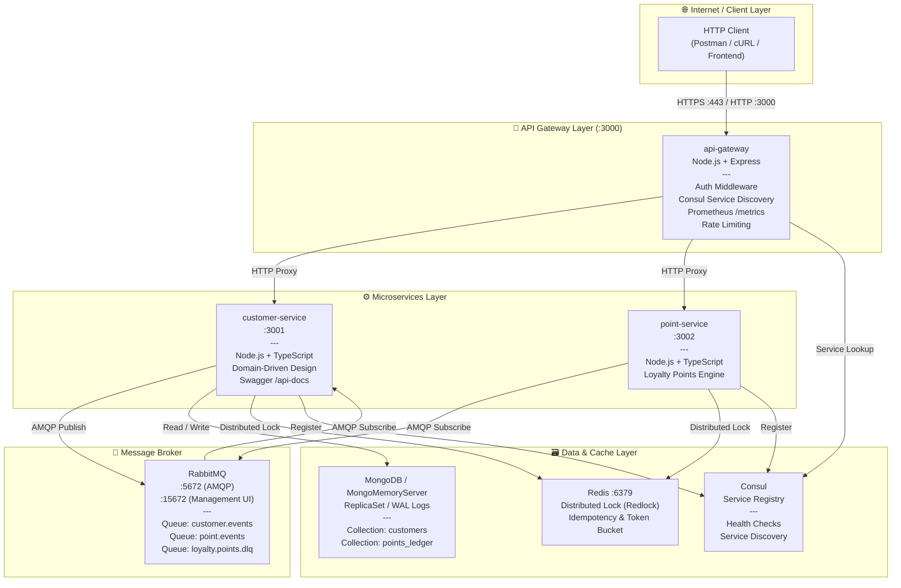
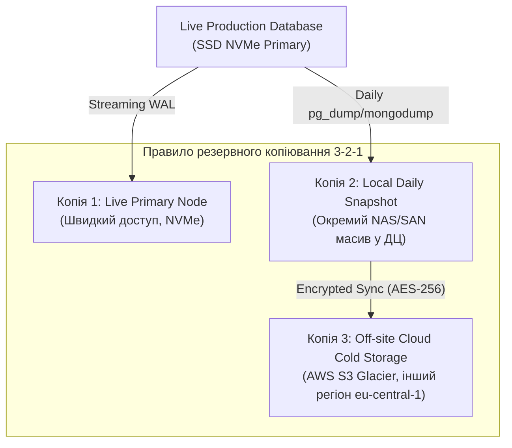

# Infrastructure Specification Document (ISD)
## System-loyalty-customers-backend

> **Версія:** 1.1.0  
> **Дата:** 2026-11-16  
> **Статус:** Active / Production-Ready  
> **Власник:** DevOps Engineer / SRE Team  
> **Останнє оновлення:** Лабораторна робота №12 — SRE Runbooks, SLO/SLA та Backup Policy  

---

## 1. Мережева Топологія



---

## 2. Середовища (Environments)

| Параметр | Development | Test (CI) | Production (Target) |
| :--- | :---: | :---: | :---: |
| **Platform** | Windows / macOS local | GitHub Actions (ubuntu-latest) | Cloud VPS / Kubernetes (EKS/GKE) |
| **Node.js** | v24.x | v20 LTS | v20 LTS (Alpine Container) |
| **Database** | MongoMemoryServer | MongoMemoryServer | MongoDB ReplicaSet (3 nodes) |
| **Cache / Lock** | Redis 7.x (local) | Redis (mock/container) | Redis Cluster (HA Sentinel) |
| **RabbitMQ** | Local Docker | — (mocked) | CloudAMQP High-Availability |
| **API Gateway** | localhost:3000 | — | Nginx Ingress / Cloudflare SSL |
| **Customer Service** | localhost:3001 | localhost:3001 | container:3001 (Replica count >= 2) |
| **Point Service** | localhost:3002 | — | container:3002 (Replica count >= 2) |
| **Secret Management** | `.env` (gitignored) | GitHub Secrets | HashiCorp Vault / AWS Secrets Manager |
| **Monitoring** | Console logs | GitHub Actions logs | Prometheus + Grafana + Alertmanager |

---

## 3. CI/CD Пайплайн (GitHub Actions)

Система використовує паралельні та взаємодоповнюючі конвеєри безперервної інтеграції:
1. **`.github/workflows/docs.yml`**: Перевірка контрактів Spectral, аудит дат актуальності документації та збірка MkDocs у режимі `--strict`.
2. **`.github/workflows/complexity-hotspots.yml`**: Семантичний аудит складності даних Чепіна, мутаційні тести, Halstead/McCabe Quality Gate.

---

## 4. Експлуатаційні процедури (Operations & Reliability Engineering)

### 4.1. Процедура штатного розгортання релізу
Розгортання здійснюється за схемою **Blue-Green** або **Rolling Update** для забезпечення нульового простою (Zero Downtime):

```bash
# 1. Завантаження оновлених образів або коду
git fetch origin main && git checkout tags/docs-v1.0

# 2. Встановлення виробничих залежностей
npm ci --legacy-peer-deps --omit=dev

# 3. Компіляція TypeScript артефактів
npm run build --prefix customer-service

# 4. Запуск сервісів у фоновому режимі (або docker compose up -d)
docker compose up -d --build customer-service point-service

# 5. Верифікація Health Check (Smoke Testing)
curl -f -s http://localhost:3000/health | jq .
# Критерій: "status": "UP" по всіх підсистемах (db, redis, rabbitmq)
```

### 4.2. Порядок оновлення з міграціями даних
Усі міграції бази даних підлягають версійному контролю та описані у журналі змін `CHANGELOG.md` за стандартом SemVer.
- **Правило сумісності (Expand-Contract Pattern):**
  1. *Фаза Expand (Попередня сумісність):* Додаються нові поля та індекси без видалення старих. Новий реліз розгортається паралельно зі старим.
  2. *Фаза Data Backfill:* Асинхронний скрипт заповнює нові поля історичними даними.
  3. *Фаза Contract:* Після перемикання 100% трафіку на нову версію, окремим релізом видаляються застарілі атрибути схеми.
- **Команди виконання міграції:**
  ```bash
  # Виконання міграції вперед
  npm run db:migrate --prefix customer-service
  
  # Екстрений відкат міграції (Rollback)
  npm run db:migrate:undo --prefix customer-service
  ```

### 4.3. Процедура відновлення після аварії (Disaster Recovery Order)
Під час холодного старту або повного збою інфраструктури підняття сервісів виконується **суворо за графом залежностей**:

```
[1. Базові сховища]        PostgreSQL / MongoDB  ──►  Redis Cluster
                                     │                     │
                                     ▼                     ▼
[2. Асинхронна шина]                 RabbitMQ Message Broker
                                                │
                                                ▼
[3. Доменні сервіси]         point-service   &   customer-service
                                                │
                                                ▼
[4. Точка входу]                           api-gateway
```

**Консольний регламент відновлення:**
```bash
# Крок 1: Запуск бази даних та перевірка коннекту
docker compose start mongodb redis
until docker compose exec redis redis-cli ping | grep -q PONG; do sleep 2; done

# Крок 2: Запуск брокера повідомлень
docker compose start rabbitmq
until docker compose exec rabbitmq rabbitmqctl status | grep -q "Running"; do sleep 3; done

# Крок 3: Запуск доменних мікросервісів
docker compose start point-service customer-service
sleep 5

# Крок 4: Запуск API Gateway
docker compose start api-gateway

# Крок 5: Повний аудит готовності
curl -f http://localhost:3000/health
```

---

## 5. Reliability Engineering: Розрахунок RTO та RPO

| Параметр | Інженерне визначення | Цільовий норматив | Розрахункове обґрунтування |
| :--- | :--- | :---: | :--- |
| **RTO** (Recovery Time Objective) | Максимально допустимий час простою системи до повного відновлення | **< 15 хвилин** | 5 хв — виявлення алертом + 5 хв — авто-рестарт контейнерів або промоушн репліки + 5 хв — верифікація |
| **RPO** (Recovery Point Objective) | Максимально допустимий обсяг втрати транзакційних даних у часі | **< 5 хвилин** | Забезпечується безперервною реплікацією WAL-логів (Write-Ahead Logging) кожні 5 хв на віддалене сховище |
| **Uptime SLO** | Внутрішня ціль доступності за 30-денним вікном | **≥ 99.5%** | Допустимий ліміт простою (Error Budget) = **216 хвилин на місяць** |
| **Uptime SLA** | Зовнішній договірний рівень доступності | **≥ 99.0%** | Допустимий ліміт простою до сплати неустойки = **432 хвилини на місяць** |
| **Буфер надійності** | Запас часу між інженерним SLO та бізнес SLA | **0.5% (216 хв)** | Забезпечує вирішення інцидентів до порушення юридичних зобов'язань |

---

## 6. Політика резервного копіювання (Backup Policy 3-2-1)

Для забезпечення фінансової та юридичної цілісності даних клієнтів впроваджено міжнародний стандарт **3-2-1**:



1. **3 копії даних:** 1 основна виробнича + 1 локальна резервна + 1 географічно ізольована хмарна копія.
2. **2 різні носії:** Високошвидкісні масиви SSD (Primary/Replica) та незалежне блочне/об'єктне сховище (S3/Glacier).
3. **1 копія поза майданчиком (Off-site):** Хмарний регіон, фізично віддалений від основного дата-центру на > 500 км для захисту від техногенних катастроф.

### 6.1. Розклад та глибина зберігання (Retention Schedule)
- **Повні копії (Full Backup):** Щотижня у неділю о 02:00 UTC (зберігаються 90 днів).
- **Диференційні / Інкрементні копії (Incremental):** Щодня о 03:00 UTC (зберігаються 30 днів).
- **Журнали транзакцій (WAL / Oplog streaming):** Кожні 5 хвилин для забезпечення RPO < 5 хв (зберігаються 7 днів).
- **Шифрування:** Усі резервні архіви шифруються за алгоритмом **AES-256-GCM** з використанням ключів AWS KMS або Vault.

### 6.2. Регламент процедури тестового відновлення (Restore Drill)
За канонічним правилом Лекції 10:  
> **«Резервна копія, відновлення з якої ніколи не перевірялося, резервною копією не вважається!»**

- **Періодичність:** Кожен перший вівторок місяця о 10:00 UTC.
- **Середовище:** Ізольоване Staging-середовище (Sandbox без доступу до Production).
- **Покроковий регламент Restore Drill:**
  1. Автоматичне завантаження останнього повного бекапу з AWS S3.
  2. Перевірка контрольної суми архіву: `sha256sum -c backup_checksum.sha256`.
  3. Розгортання бази даних у тестовий інстанс:
     ```bash
     mongorestore --drop --gzip --archive=/tmp/backup_monthly.gz
     ```
  4. Запуск скрипта цілісності даних (Data Integrity Smoke Test):
     - Перевірка відповідності суми балансів клієнтів та проводок у журналі аудиту (`points_ledger`).
     - Перевірка цілісності індексів та унікальності ідентифікаторів.
  5. Фіксація результатів у журналі аудиту відновлення (`reports/restore-drill-log.md`). Критерій успіху: відновлення триває **менше 10 хвилин** (RTO), розбіжність балансів = **0.00 UAH**.

---

## 7. Security Architecture & Controls

| Шар | Механізм захисту | Статус |
| :--- | :--- | :---: |
| Secrets Management | `.env` (gitignored) + GitHub Secrets | ✅ |
| Secret Scanning | Gitleaks pre-commit hook (блокує витік токенів) | ✅ |
| PII Data Masking | `PiiSanitizer` (маскування телефонів/email у логах) | ✅ |
| Input Validation | `validation.middleware.ts` (валідація DTO за OpenAPI) | ✅ |
| Error Sanitization | `errorHandler.middleware.ts` (приховує стек-трейси у production) | ✅ |
| Rate Limiting | Token Bucket на рівні API Gateway (захист від DDoS) | ✅ |
| GDPR Compliance | Crypto-shredding та стирання даних за запитом (ADR-0007) | ✅ |

---

> Пов'язані документи (Obsidian Graph): [[sdd]] | [[maintenance]] | [[handover]] | [[RB-001]] | [[slo]] | [[ADR-0001-nodejs-typescript]]
