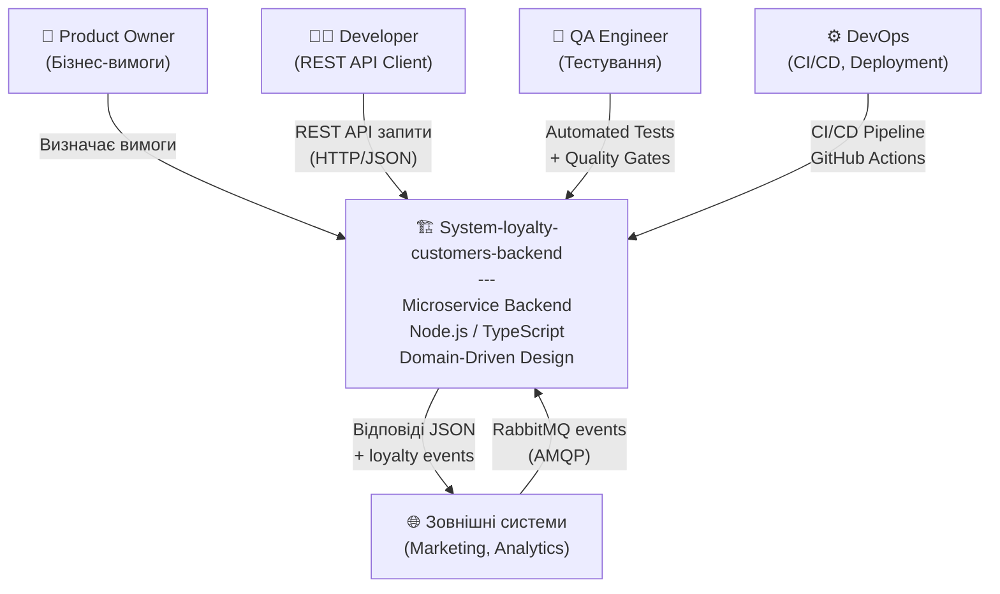
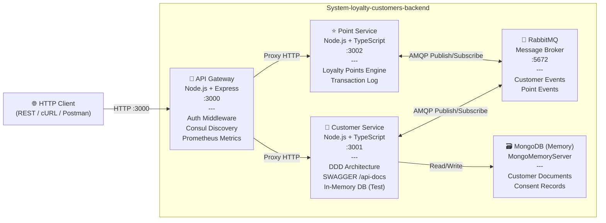
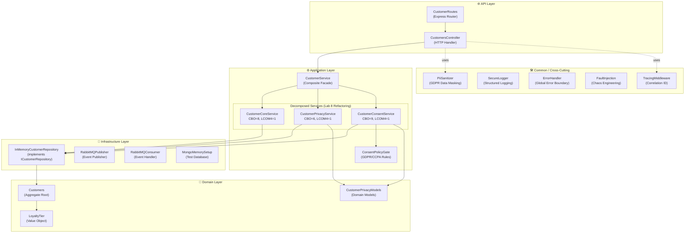
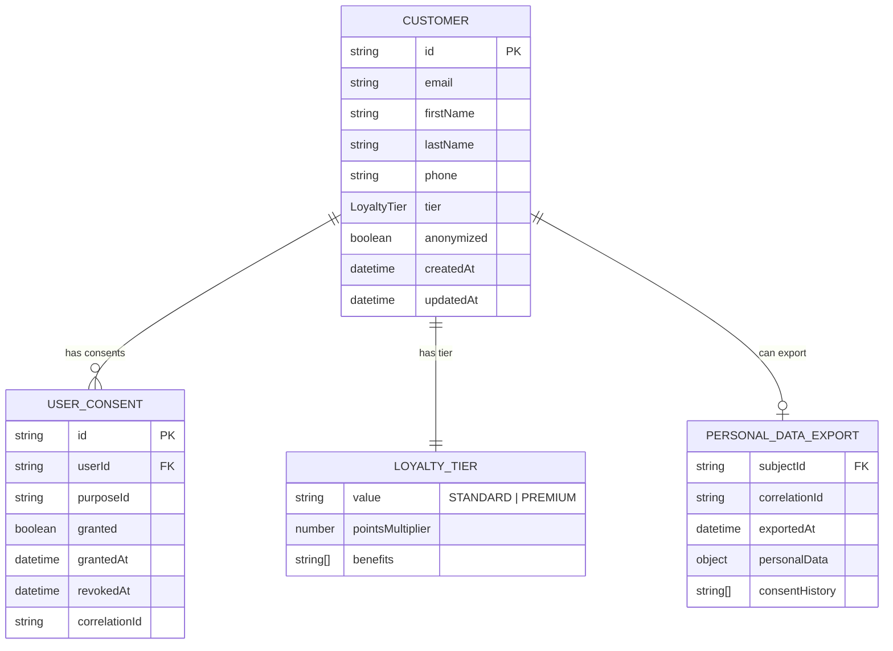

# System Design Document (SDD)
## System-loyalty-customers-backend

> **Версія:** 1.0.0  
> **Дата:** 2026-11-16  
> **Статус:** Active  
> **Розробник:** Horizon-55  
> **Останнє оновлення:** Лабораторна робота №10 — Documentation Engineering  

---

## 1. Системний Контекст (C4 Level 1 — System Context)



**Опис системи:**  
`System-loyalty-customers-backend` — це мікросервісний backend для управління лояльністю клієнтів. Система обробляє реєстрацію клієнтів, управління персональними даними (GDPR/CCPA), систему згод (Consent Management) та програму лояльності (Loyalty Tiers: Standard → Premium).

---

## 2. Контейнерна Діаграма (C4 Level 2 — Container)



---

## 3. Компонентна Діаграма (C4 Level 3 — Component: Customer Service)



---

## 4. Доменна Модель (ER-Діаграма)



---

## 5. API Специфікація

### Base URL: `http://localhost:3001/api/v1`

| Метод | Шлях | Призначення | Auth |
| :---: | :--- | :--- | :---: |
| `POST` | `/customers` | Реєстрація нового клієнта | — |
| `GET` | `/customers/:id` | Отримати клієнта за ID | — |
| `POST` | `/customers/:id/upgrade-to-premium` | Підвищення до Premium tier | — |
| `GET` | `/customers/:id/personal-data` | GDPR export персональних даних | Bearer |
| `POST` | `/customers/:id/anonymize` | Анонімізація (GDPR right to erasure) | Bearer |
| `POST` | `/customers/:id/consents` | Надання згоди (CCPA/GDPR) | Bearer |
| `DELETE` | `/customers/:id/consents/:purposeId` | Відкликання згоди | Bearer |
| `GET` | `/customers/:id/consents` | Перегляд всіх згод | Bearer |
| `POST` | `/customers/:id/marketing` | Маркетингова розсилка (з перевіркою consent) | Bearer |
| `GET` | `/health` | Health check endpoint | — |
| `GET` | `/api-docs` | Swagger UI документація | — |

### Приклад запиту (POST /customers):
```json
{
  "email": "john.doe@example.com",
  "firstName": "John",
  "lastName": "Doe",
  "phone": "+380671234567"
}
```

### Приклад відповіді:
```json
{
  "id": "uuid-v4",
  "email": "john.doe@example.com",
  "firstName": "John",
  "lastName": "Doe",
  "tier": "STANDARD",
  "anonymized": false,
  "createdAt": "2026-11-16T10:00:00.000Z"
}
```

---

## 6. Ключові Архітектурні Рішення (посилання на ADR)

| Рішення | ADR | Статус |
| :--- | :---: | :---: |
| Node.js + TypeScript + Express | [ADR-0001](./adr/ADR-0001-nodejs-typescript.md) | Accepted |
| In-Memory Repository для тестів | [ADR-0002](./adr/ADR-0002-in-memory-repository.md) | Accepted |
| GQM-матриця вимірювання якості | [ADR-0003](./adr/ADR-0003-gqm-quality-matrix.md) | Accepted |
| CC ≤ 10, Halstead Complexity Thresholds | [ADR-0004](./adr/ADR-0004-complexity-thresholds.md) | Accepted |
| Chapin Semantic Audit + Hotspots | [ADR-0005](./adr/ADR-0005-chapin-semantic-audit.md) | Accepted |
| God Object → Interface Decomposition | [ADR-0006](./adr/ADR-0006-god-object-decomposition.md) | Accepted |
| Replace Inheritance with Composition | [ADR-0007](./adr/ADR-0007-composition-over-inheritance.md) | Accepted |
| SQALE Financial Model for Tech Debt | [ADR-0008](./adr/ADR-0008-sqale-financial-model.md) | Accepted |

---

> Пов'язані документи (Obsidian Graph): [[isd]] | [[maintenance]] | [[handover]] | [[ADR-0001-nodejs-typescript]]
