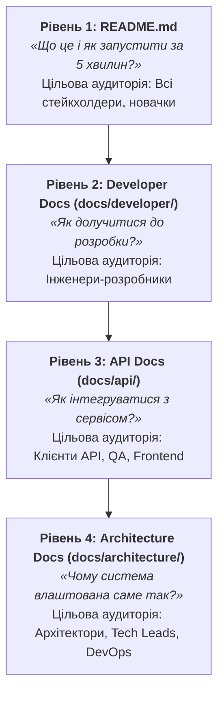

# Корпоративна база знань: System-loyalty-customers-backend

> **Концепція:** Documentation as Code (DaC)  
> **Принцип:** Single Source of Truth (SSOT) — документація зберігається разом із вихідним кодом, версіонується через Git і верифікується у CI/CD.  
> **Теги:** #architecture #developer #api #ops  

Ласкаво просимо до офіційної інженерної бази знань проєкту `System-loyalty-customers-backend` — мікросервісного бекенду програми лояльності клієнтів із підтримкою вимог GDPR/CCPA.

---

## 🏛️ Чотирирівнева піраміда документації

База знань структурована за **чотирирівневою пірамідою знань (Architecture Documentation Pyramid)**, де кожен рівень адресовано відповідній цільовій аудиторії:

---

## 🧭 Навігація по розділах

| Рівень | Розділ | Посилання | Опис |
| :---: | :--- | :--- | :--- |
| **1** | **Головна (Швидкий старт)** | [Огляд системи (README)](index.md) | Призначення системи, стек технологій, швидкий запуск за 5 кроків. |
| **2** | **Для розробників** | [Керівництво контриб'ютора](developer/CONTRIBUTING.md) [Локальне середовище](developer/environment.md) [Стандарти коду](developer/coding-standards.md) | Регламент розробки, `docs-or-don't-merge`, вимоги до середовища (Node.js 20+, Docker). |
| **3** | **API та Контракти** | [Специфікація API](api/index.md) | Машинно-читний контракт OpenAPI 3.x, інтерактивний Swagger UI, клієнтські SDK. |
| **4** | **Архітектурний паспорт** | [Системний дизайн (SDD)](architecture/sdd.md) [Інфраструктура (ISD)](architecture/isd.md) [Кущ рішень (ADR)](architecture/adr/ADR-0001-nodejs-typescript.md) [Регламент супроводу](architecture/maintenance.md) [Handover-пакет](architecture/handover.md) | C4-модель (L1–L3), ER-діаграма, мережева топологія, RTO/RPO, незмінні записи рішень. |

---

## ⚡ Інженерне правило: «Не збирається — не їде»

Вся документація підпорядковується суворому правилу валідації:
- Будь-яке бите посилання, пропущена сторінка в навігації або синтаксична помилка переривають збірку `mkdocs build --strict` із кодом завершення **Exit Code 1**.
- Злиття Pull Request блокується на рівні GitHub Actions, допоки документація не пройде 100% перевірок якості.

> Пов'язані артефакти: [[sdd]] | [[isd]] | [[maintenance]] | [[handover]]
