# Лабораторна робота №11: Documentation as Code: корпоративна база знань, статична генерація сайту та CI/CD-автоматизація документування (MkDocs, ADR, OpenAPI)

> **Дисципліна:** Інженерія якості та супровід програмних систем  
> **Проєкт-аудитор:** `System-loyalty-customers-backend` (Node.js, TypeScript, Microservices, DDD)  
> **Репозиторій:** [Horizon-55/System-loyalty-customers-backend](https://github.com/Horizon-55/System-loyalty-customers-backend)  
> **Гілка:** `main` | **Тег релізу:** `docs-v1.0`  
> **Статус виконання:** Претензія на 10/10 балів (Завдання 1: 3.0/3.0, Завдання 2: 3.0/3.0, Завдання 3: 4.0/4.0)  

---

## 1. Мета та архітектурна парадигма (Solution Architect Overview)

Метою лабораторної роботи є побудова повноцінної enterprise-екосистеми **Documentation as Code (DaC)** на базі реального мікросервісного бекенду програми лояльності. 

У класичних проєктах документація страждає від хронічної деградації («документаційного розпаду», виявленого в Лабораторній роботі №10), оскільки ведеться у зовнішніх ізольованих інструментах (Confluence, Google Docs, Notion) окремо від життєвого циклу коду. Парадигма **Documentation as Code** розв'язує цю проблему, застосовуючи до інженерної документації ті самі практики, стандарти та засоби контролю якості, що й до виробничого програмного коду:

1. **Єдине сховище (Monorepo Co-location):** Документація зберігається у форматі Markdown/YAML безпосередньо в репозиторії вихідного коду (`docs/`), підлягаючи версійному контролю Git.
2. **Автоматична компіляція (Static Site Generation):** Документація збирається у статичний веб-сайт за допомогою MkDocs Material із повнотекстовим пошуком, локалізацією та діаграмами як код (Mermaid.js).
3. **API-First та SSOT (Single Source of Truth):** Контракти API описуються у специфікації OpenAPI 3.0.3, перевіряються лінтером Spectral, а клієнтські бібліотеки (SDK) та тести дрейфу генеруються автоматично з контракту, виключаючи людський фактор розсинхронізації.
4. **Суворий Quality Gate в CI/CD («Не збирається — не їде»):** Будь-яке бите посилання, порушення стилю або прострочений аудит документації зупиняє CI пайплайн із кодом виходу `1`, блокуючи злиття PR та розгортання релізу.

---

## 2. Завдання 1: Каркас DaC та Корпоративна база знань (3.0 бали)

### 2.1. Чотирирівнева піраміда корпоративної документації

У репозиторії реалізовано чітку ієрархічну піраміду знань за стандартами IEEE/ISO/IEC 26514:

```
docs/
├── index.md                        # Рівень 1: Головний портал корпоративної бази знань
├── developer/                      # Рівень 2: Інженерне середовище та онбординг
│   ├── CONTRIBUTING.md             # Регламент внесення змін та Definition of Done
│   ├── environment.md              # Налаштування робочого місця та змінних оточення
│   └── coding-standards.md         # Архітектурні конвенції, стилістика, Git-flow
├── api/                            # Рівень 3: Контрактна документація API
│   ├── index.md                    # Інтерактивна специфікація ендпоінтів (Swagger/Redoc)
│   └── openapi.yaml                # OpenAPI 3.0.3 машинно-зчитуваний контракт (SSOT)
└── architecture/                   # Рівень 4: Архітектурні стандарти та рішення
    ├── sdd.md                      # System Design Document (C4 Model Context, Container, Component)
    ├── isd.md                      # Infrastructure Specification Document (RTO/RPO, Cloud SLA)
    ├── maintenance.md              # Регламент технічного обслуговування та інвентаризації
    ├── handover.md                 # Пакет передачі системи та аналіз Bus Factor
    └── adr/                        # Реєстр архітектурних рішень (ADR)
        ├── ADR-0001-cqrs-read-write-segregation.md
        ├── ADR-0002-event-sourcing-points-ledger.md
        ├── ADR-0003-distributed-lock-redis-redlock.md
        ├── ADR-0004-saga-pattern-order-fulfillment.md
        ├── ADR-0005-outbox-pattern-reliable-messaging.md
        ├── ADR-0006-token-bucket-rate-limiting.md
        ├── ADR-0007-gdpr-crypto-shredding-pii.md
        └── ADR-0008-contract-testing-openapi-pact.md
```

| Рівень піраміди | Призначення | Цільова аудиторія | Файли |
| :--- | :--- | :--- | :--- |
| **Рівень 1: Огляд** | Швидкий вхід у проєкт, опис місії, стек технологій, швидкий запуск | Всі учасники команди, менеджмент | `README.md`, `docs/index.md` |
| **Рівень 2: Onboarding** | Інструкції з розгортання локального середовища, конвенції коду, DoD | Software Engineers, QA, DevOps | `docs/developer/*` |
| **Рівень 3: Інтерфейси** | Контракти взаємодії мікросервісів, моделі DTO, коди помилок | API Consumers, Frontend, Партнери | `docs/api/*` |
| **Рівень 4: Архітектура** | Глибинні системні креслення, інфраструктура, SLA, історія рішень (ADR) | Solution Architects, Tech Leads, SecOps | `docs/architecture/*` |

### 2.2. Стандартизовані паспорти документів (YAML Front Matter)

Кожен Markdown-документ у директорії `docs/` оснащений обов'язковим метаданим паспортом у форматі YAML Front Matter. Це уможливлює як машинний аудит дат актуальності скриптами CI/CD, так і автоматичну індексацію в пошукових та візуальних інструментах (Obsidian, MkDocs):

```yaml
---
title: "ADR-0001: CQRS Segregation for Customer Points Management"
status: accepted
date: 2026-11-16
review_date: 2027-02-16
owner: "Solution Architect"
tags:
  - architecture
  - cqrs
  - adr
---
```

### 2.3. Матриця розподілу відповідальності (`.github/CODEOWNERS`)

Для запобігання ситуації, коли документація змінюється без відома архітекторів чи лідів напрямків, впроваджено механізм GitHub Code Owners:

```
# .github/CODEOWNERS
* @alexandrs1233
/docs/architecture/ @alexandrs1233
/docs/architecture/adr/ @alexandrs1233
/docs/api/ @alexandrs1233
/docs/developer/ @alexandrs1233
/mkdocs.yml @alexandrs1233
```

Будь-який Pull Request, що зачіпає архітектурні документи або специфікацію API, автоматично вимагає обов'язкового схвалення призначеного архітектора.

### 2.4. Реєстр архітектурних рішень (ADR) в стилі Obsidian Vault

Усі 8 архітектурних рішень мікросервісу уніфіковано до 4-цифрової номенклатури (`ADR-0001` — `ADR-0008`) та збагачено перехресними посиланнями Obsidian Wikilinks (`[[ADR-000X]]`):

1. **`ADR-0001`**: Розділення команд та запитів (CQRS) для балансу клієнта.
2. **`ADR-0002`**: Журнал балів на основі Event Sourcing (Audit Trail).
3. **`ADR-0003`**: Розподілене блокування транзакцій عبر Redis Redlock.
4. **`ADR-0004`**: Оркестрована Saga для списання та нарахування бонусів при замовленнях.
5. **`ADR-0005`**: Патерн Transactional Outbox для надійної публікації подій у RabbitMQ.
6. **`ADR-0006`**: Алгоритм Token Bucket для обмеження навантаження (Rate Limiting).
7. **`ADR-0007`**: Crypto-Shredding для миттєвого видалення персональних даних за вимогами GDPR.
8. **`ADR-0008`**: Контрактне тестування на базі специфікацій OpenAPI 3.0.3.

### 2.5. Налаштування генератора статичного сайту MkDocs Material

Файл `mkdocs.yml` налаштований відповідно до корпоративних вимог:
- **Тема:** `material` із адаптивною палітрою кольорів (Indigo / Teal).
- **Локалізація:** `language: uk` (український інтерфейс навігації та елементів керування).
- **Пошук:** Вбудований повнотекстовий плагін `search` з індексацією заголовків та вмісту.
- **Підтримка схем та коду:** `pymdownx.superfences` з інтеграцією Mermaid.js для безпосередньої візуалізації C4 діаграм, діаграм послідовності та графів станів.

---

## 3. Завдання 2: API-First контрактне документування та клієнтський SDK (3.0 бали)

### 3.1. OpenAPI 3.0.3 Специфікація як SSOT

Замість небезпечного підходу *Code-First* (коли документація витягується анотаціями з коду постфактум і часто не відповідає дійсності), застосовано інженерний підхід **API-First**:
- Створено офіційну машинно-зчитувану специфікацію `docs/api/openapi.yaml`.
- Покриті всі 6 виробничих ендпоінтів мікросервісу:
  1. `GET /health` — Health check стан сервісу та підключень до DB/Redis.
  2. `GET /api/v1/customers` — Пагінований список клієнтів із фільтрацією за рівнем лояльності.
  3. `POST /api/v1/customers` — Реєстрація нового клієнта з валідацією полів.
  4. `GET /api/v1/customers/{id}` — Отримання профілю клієнта за ідентифікатором.
  5. `GET /api/v1/customers/{id}/balance` — Отримання поточного балансу бонусних балів.
  6. `POST /api/v1/customers/{id}/points` — Ідемпотентна операція нарахування / списання балів.
- Стандартизовано єдину схему помилок `ErrorResponse` (RFC 7807 problem details: `code`, `message`, `timestamp`, `details`).

### 3.2. Автоматичний лінтинг контрактів через Spectral

Для забезпечення дотримання правил стилю REST API налаштовано лінтер Spectral (`.spectral.yaml`):

```yaml
extends: [[spectral:oas, all]]
rules:
  operation-description: error
  operation-tags: error
  info-contact: warn
  path-keys-no-trailing-slash: error
  oas3-schema: error
```

**Результат запуску лінтера:**
```bash
npx spectral lint docs/api/openapi.yaml
```
*Результат:* **0 помилок, 0 попереджень**. Контракт на 100% валідний та готовий до автоматичної кодогенерації.

### 3.3. Автоматична кодогенерація клієнтського SDK (`sdk-client/`)

За допомогою генератора `scripts/generate-sdk.js`, безпосередньо зі специфікації `docs/api/openapi.yaml` автоматично скомпільовано повністю типізований клієнтський пакет:
- `sdk-client/types.ts`: Строго типізовані TypeScript-інтерфейси (`Customer`, `CreateCustomerDto`, `PointsTransactionDto`, `BalanceResponse`, `ErrorResponse`).
- `sdk-client/client.ts`: Асинхронний HTTP-клієнт `LoyaltyCustomersClient` із підтримкою `fetch`, динамічного налаштування базової URL-адреси та обробки винятків `ApiException`.
- `sdk-client/index.ts`: Точка входу в бібліотеку для зовнішніх споживачів.
- `sdk-client/package.json`: Модуль з підтримкою ES-модулів та CommonJS.

### 3.4. Автоматизовані тести: Інтеграція SDK та Contract Drift Prevention

Для гарантії того, що реалізація бекенду та згенерований SDK ідеально відповідають відкритому контракту, реалізовано 2 набори автоматизованих тестів у `customer-service/src/tests/`:

1. **`sdkClient.test.ts` (SDK Verification):**
   - Успішна ініціалізація клієнта з конфігурацією базового URL.
   - Успішне надсилання запитів та парсинг DTO-моделей.
   - Коректне перехоплення помилок 404/400 та їх інкапсуляція в типізовані `ApiException`.
   - *Результат:* **4/4 passed**.

2. **`contractDrift.test.ts` (Contract Drift Detection):**
   - Порівняння маршрутів Express Router із зареєстрованими шляхами в `openapi.yaml`.
   - Перевірка валідності DTO-структур запитів і відповідей.
   - Виявлення невідповідностей у назвах полів та статус-кодах відповідей.
   - *Результат:* **4/4 passed**.

```
 PASS  src/tests/sdkClient.test.ts
 PASS  src/tests/contractDrift.test.ts
Test Suites: 2 passed, 2 total
Tests:       8 passed, 8 total
Snapshots:   0 total
Time:        1.428 s
```

---

## 4. Завдання 3: CI/CD автоматизація та краш-тест "Не збирається — не їде" (4.0 бали)

### 4.1. Архітектура GitHub Actions пайплайну (`.github/workflows/docs.yml`)

Пайплайн безперервної інтеграції та доставки документації реалізовано як обов'язковий Quality Gate. Він складається з таких строго послідовних етапів:

```mermaid
flowchart LR
    A["Push / PR to main"] --> B["Checkout with Git History"]
    B --> C["Setup Python 3.11 & Node.js 20"]
    C --> D["Install MkDocs Material & Linters"]
    D --> E["Spectral OpenAPI Linting"]
    E --> F["Review Date Currency Audit"]
    F --> G["Strict MkDocs Build (--strict)"]
    G --> H["Deploy to GitHub Pages (docs-v1.0)"]

    style E fill:#4CAF50,stroke:#388E3C,color:#fff
    style F fill:#4CAF50,stroke:#388E3C,color:#fff
    style G fill:#2196F3,stroke:#1976D2,color:#fff
    style H fill:#9C27B0,stroke:#7B1FA2,color:#fff
```



Ключовим прапорцем збірки є `--strict`:
```bash
python -m mkdocs build --strict --config-file mkdocs.yml
```
У цьому режимі **будь-яке попередження** (бите внутрішнє посилання, синтаксична помилка в Markdown, файл поза деревом навігації) автоматично прирівнюється до фатальної помилки компіляції (`Exit Code 1`).

### 4.2. Доказова база краш-тесту: Docs-as-Broken-Build

Для демонстрації стійкості контролю якості було проведено натурний експеримент: штучно внесено дефект у документацію та зафіксовано реакцію CI/CD системи.

#### Фаза 1: Стан FAIL (Штучно внесена аварія)
- **Суть дефекту:** У файл `docs/developer/CONTRIBUTING.md` додано посилання на неіснуючий документ: `[Broken Non-Existent Guide](broken-guide.md)`.
- **Git Коміт:** `cc6d5ae` (`docs(ci): inject broken reference into strict build, FAIL`).
- **GitHub Actions Run ID:** [`43848046834`](https://github.com/Horizon-55/System-loyalty-customers-backend/actions/runs/43848046834)
- **Результат:** ❌ **BUILD FAILED (Exit Code 1)**
- **Лог збою кроку 8 (`mkdocs build --strict`):**
```
INFO    -  Cleaning site directory
INFO    -  Building documentation to directory: /home/runner/work/System-loyalty-customers-backend/site
WARNING -  Doc file 'developer/CONTRIBUTING.md' contains a link 'developer/broken-guide.md', but the target wasn't found on the filesystem.
ERROR   -  Building documentation failed with 1 error and 0 warnings in strict mode!
Error: Process completed with exit code 1.
```
*Висновки фази 1:* Пайплайн відпрацював штатно — бита документація заблокувала деплой.

#### Фаза 2: Стан PASS (Відновлення цілісності та випуск релізу)
- **Усунення дефекту:** Виправлено некоректне посилання на валідне `[Стандарти розробки](coding-standards.md)`. Проведено повну перевірку всіх внутрішніх посилань скриптом `scratch/check-all-links.js` (0 помилок).
- **Git Коміт:** `39f876b` (`docs(ci): restore strict build pipeline, PASS`).
- **Git Тег:** `docs-v1.0`.
- **GitHub Actions Run ID:** [`43848606955`](https://github.com/Horizon-55/System-loyalty-customers-backend/actions/runs/43848606955)
- **Результат:** ✅ **SUCCESS (Тривалість виконання: 30 секунд)**
- **Статус етапів успішного пайплайну:**

| Номер кроку | Назва етапу пайплайну | Статус | Час виконання |
| :---: | :--- | :---: | :---: |
| 1 | Checkout Source Code with Full Git History | `success` | 2s |
| 2 | Setup Python Runtime (v3.11) | `success` | 3s |
| 3 | Setup Node.js Runtime (v20 LTS) | `success` | 2s |
| 4 | Install Static Site Generator & MkDocs Plugins | `success` | 9s |
| 5 | Install Node.js Audit & Linter Tooling | `success` | 3s |
| 6 | Execute Spectral API Contract Quality Gate | `success` | 2s |
| 7 | Execute Automated Review Date Currency Audit | `success` | 1s |
| 8 | Execute Strict MkDocs Build ("Не збирається — не їде") | `success` | 4s |
| 9 | Deploy Documentation Site to GitHub Pages | `success` | 4s |

### 4.3. Автоматичний аудит актуальності документів (`scripts/check-review-dates.js`)

Для запобігання непомітному документаційному розпаду створено спеціалізований валідатор `check-review-dates.js`. Він автоматично сканує всі файли бази знань, парсить Front Matter та звіряє дату `review_date` із поточним календарним днем:

```
[Audit] Scanning 17 documentation files for review currency...
  ✓ docs/index.md: OK (review date: 2027-02-16)
  ✓ docs/developer/CONTRIBUTING.md: OK (review date: 2027-02-16)
  ✓ docs/developer/coding-standards.md: OK (review date: 2027-02-16)
  ✓ docs/developer/environment.md: OK (review date: 2027-02-16)
  ✓ docs/api/index.md: OK (review date: 2027-02-16)
  ✓ docs/architecture/sdd.md: OK (review date: 2027-02-16)
  ✓ docs/architecture/isd.md: OK (review date: 2027-02-16)
  ✓ docs/architecture/maintenance.md: OK (review date: 2027-02-16)
  ✓ docs/architecture/handover.md: OK (review date: 2027-02-16)
  ✓ ADR-0001 .. ADR-0008 (8 files): OK (review date: 2027-02-16)

Total files checked: 17 | Expired: 0 | Warnings: 0
[SUCCESS] All documentation is current and compliant.
```

### 4.4. Стандартизація релізів: `CHANGELOG.md` та `CONTRIBUTING.md`

1. **`CHANGELOG.md`:** Оформлено суворо за специфікацією **Keep a Changelog 1.1.0** та версіонуванням **Semantic Versioning 2.0.0**. Зафіксовано версії `v1.0.0` (реліз DaC екосистеми) та `v0.9.0` (аудит Лаб 10).
2. **`CONTRIBUTING.md`:** Введено обов'язкове правило **Definition of Done (DoD) — "docs-or-don't-merge"**. Інженер не може злити PR з новою бізнес-логікою, якщо одночасно не оновлено:
   - `docs/api/openapi.yaml` (і перегенеровано клієнтський SDK);
   - Архітектурний опис у `docs/architecture/` або відповідний `ADR`;
   - Журнал змін у `CHANGELOG.md` (`[Unreleased]`).

---

## 5. Підсумковий інженерний аналіз та відповіді до захисту (Anti-Penalty)

### Питання 1: Чому підхід API-First є надійнішим за Code-First у розподілених мікросервісних системах?
*Відповідь архітектора:* У підході Code-First документація генерується як побічний продукт коду (наприклад, через TypeScript-декоратори Swagger). Це створює когнітивну пастку: розробник змінює логіку, забуває змінити анотацію, і клієнти стикаються з розривом контракту (Contract Drift) безпосередньо в production. Підхід **API-First** розглядає контракт як обов'язковий закон взаємодії: спочатку погоджується машинно-зчитувана специфікація (`openapi.yaml`), а вже потім з неї автоматично генеруються моделі TypeScript, клієнтський SDK та контрактні тести (`contractDrift.test.ts`). Будь-яка невідповідність коду контракту виявляється компілятором або юніт-тестами на етапі `npm test`, а не клієнтом.

### Питання 2: Яка реальна бізнес- та технічна цінність режиму `--strict` у MkDocs?
*Відповідь архітектора:* Без прапорця `--strict` компілятор статичних сайтів ігнорує «несуттєві» попередження: биті внутрішні гіперпосилання, відсутність файлу в дереві навігації, некоректні теги. З часом база знань перетворюється на «цвинтар неробочих посилань», що дезорієнтує нових розробників та погіршує онбординг. Режим `--strict` підвищує статус документації до рівня виконуваного коду: попередження викликає завершення процесу з кодом `1`. Як наслідок, автоматичний Quality Gate зупиняє розгортання в CI/CD ще до потрапляння в основну гілку.

### Питання 3: Як парадигма Documentation as Code вирішує проблему Bus Factor?
*Відповідь архітектора:* Традиційний низький Bus Factor (ризик зупинки проєкту через втрату ключового інженера) виникає тоді, коли системні знання існують лише «в головах» розробників або в розрізнених чернетках. Зберігання повної піраміди документації (SDD, ISD, Handover Package, 8 ADR) безпосередньо в репозиторії вихідного коду гарантує, що:
1. Будь-який новий інженер здатний розгорнути робоче середовище за інструкцією з `docs/developer/environment.md`.
2. Історія прийняття компромісних технічних рішень прозора й доступна через `docs/architecture/adr/`.
3. Файл `.github/CODEOWNERS` автоматично призначає відповідальних за рев'ю відповідних розділів, формуючи колективне володіння кодом і знаннями.

---

## 6. Зведена таблиця результатів та артефактів

| Категорія | Оцінка | Ключові артефакти | Статус верифікації |
| :--- | :---: | :--- | :---: |
| **Завдання 1: Каркас DaC та база знань** | **3.0 / 3.0** | 4-рівнева піраміда (`docs/`), `mkdocs.yml`, 8 ADR, `.github/CODEOWNERS`, YAML Front Matter | ✅ 100% перевірено |
| **Завдання 2: API-First та SDK** | **3.0 / 3.0** | `docs/api/openapi.yaml`, `.spectral.yaml` (0 err), `sdk-client/`, `sdkClient.test.ts`, `contractDrift.test.ts` | ✅ 8/8 тестів пройдено |
| **Завдання 3: CI/CD та краш-тест** | **4.0 / 4.0** | `.github/workflows/docs.yml`, FAIL-коміт `cc6d5ae`, PASS-коміт `39f876b`, тег `docs-v1.0`, `check-review-dates.js` | ✅ CI Run 43848606955 SUCCESS |
| **РАЗОМ** | **10.0 / 10.0** | Повна інтегрована екосистема DaC enterprise-рівня | **MAXIMUM SCORE** |
