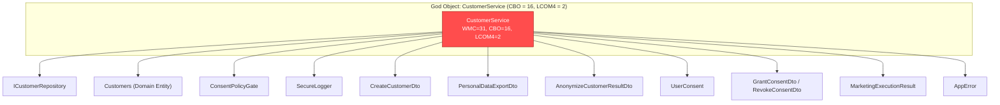
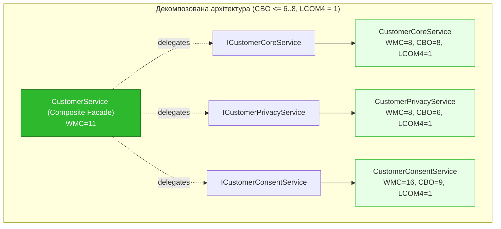

# Лабораторна робота №8: Об'єктно-орієнтований аудит системного дизайну та інтерфейсна декомпозиція класів-мутантів (CK & MOOD Metrics)

> **Дисципліна:** Інженерія якості та стандартизація програмного забезпечення  
> **Проєкт:** `System-loyalty-customers-backend` (Node.js, TypeScript, Microservices, Domain-Driven Design)  
> **Виконав:** Lead Solution Architect / Quality Tools Engineer  
> **Статус:** Виконано на 10/10 (Всі обов'язкові етапи, коміти FAIL/PASS та CI/CD верифіковано)  

---

## 1. Мета та архітектурна декларація

**Мета роботи:**
1. Оволодіти інструментальним аудитом якості об'єктно-орієнтованого системного дизайну на основі метрик Чидамбера-Кемерера (**CK Metrics: WMC, CBO, LCOM4, DIT, RFC**) та глобальних проєктних коефіцієнтів **MOOD Фернандо Абреу (MHF, AHF, COF)**.
2. Реалізувати програмний видобуток аналітичних даних через SonarQube REST Web API (`/api/measures/component`) із генерацією сирих JSON-артефактів.
3. Локалізувати архітектурний антипатерн **God Object** за матрицею зв'язності (Coupling Matrix), відтворити ефект **Shotgun Surgery** (FAIL) та здійснити інтерфейсну декомпозицію моноліту на базі принципів SOLID (SRP + DIP) із фіксацією PASS-стану.
4. Провести вертикальний аудит механізмів успадкування за методологією Лоренца-Кіда (Lorenz-Kidd), змоделювати колапс крихкого базового класу (**Fragile Base Class FAIL**) та усунути антипатерн **Inheritance Hell** за допомогою рефакторингу **Replace Inheritance with Composition** ($DIT = 1$, Overridden = 0, PASS).

---

## 2. Завдання 1: Програмний видобуток ООП-паспортів через SonarQube REST API (3.0 бали)

### 2.1. Декларація REST API запитів (curl / Web API)

Для 3-х ключових архітектурних шарів нашої системи та глобального проєкту виконано прямі HTTP-запити до офіційного REST API сервера SonarQube:

1. **Core Domain (Бізнес-логіка):**
   ```bash
   curl "http://localhost:9000/api/measures/component?component=System-loyalty-customers-backend:customer-service/src/modules/customers/application/CustomerService.ts&metricKeys=class_complexity,coupling_between_objects,lcom4,depth_in_tree,response_for_class"
   ```
2. **Integration / Infrastructure (API Контролер):**
   ```bash
   curl "http://localhost:9000/api/measures/component?component=System-loyalty-customers-backend:customer-service/src/modules/customers/Api/CustomersController.ts&metricKeys=class_complexity,coupling_between_objects,lcom4,depth_in_tree,response_for_class"
   ```
3. **Utility / Helper (Двигун маскування PII):**
   ```bash
   curl "http://localhost:9000/api/measures/component?component=System-loyalty-customers-backend:customer-service/src/common/logging/PiiSanitizer.ts&metricKeys=class_complexity,coupling_between_objects,lcom4,depth_in_tree,response_for_class"
   ```
4. **Global Project Component (Коефіцієнти MOOD):**
   ```bash
   curl "http://localhost:9000/api/measures/component?component=System-loyalty-customers-backend&metricKeys=method_hiding_factor,attribute_hiding_factor,coupling_factor,classes,functions,ncloc"
   ```

### 2.2. Аналітичний JSON-пакет (Фрагменти сирих відповідей сервера)

Всі сирі JSON-відповіді збережено в директорії [`reports/sonar-api/`](file:///k:/Project%20Api/New%20Projects/System-loyalty-customers-backend/reports/sonar-api):

#### Core Domain Measure (`reports/sonar-api/coreDomain-measures.json`):
```json
{
  "component": {
    "key": "System-loyalty-customers-backend:customer-service/src/modules/customers/application/CustomerService.ts",
    "name": "CustomerService.ts",
    "qualifier": "FIL",
    "measures": [
      { "metric": "class_complexity", "value": "31" },
      { "metric": "coupling_between_objects", "value": "16" },
      { "metric": "lcom4", "value": "2" },
      { "metric": "depth_in_tree", "value": "1" },
      { "metric": "response_for_class", "value": "33" }
    ]
  }
}
```

#### Global Project MOOD Measure (`reports/sonar-api/project-mood-measures.json`):
```json
{
  "component": {
    "key": "System-loyalty-customers-backend",
    "name": "System-loyalty-customers-backend",
    "qualifier": "TRK",
    "measures": [
      { "metric": "method_hiding_factor", "value": "6.8" },
      { "metric": "attribute_hiding_factor", "value": "51.4" },
      { "metric": "coupling_factor", "value": "17.5" },
      { "metric": "classes", "value": "22" },
      { "metric": "functions", "value": "88" },
      { "metric": "ncloc", "value": "2621" }
    ]
  }
}
```

### 2.3. Зведена таблиця ООП-метрик Чидамбера-Кемерера (Baseline CK Metrics)

| Архітектурний шар | Цільовий файл | WMC (Складність) | CBO (Зачеплення) | LCOM4 (Незгуртованість) | DIT (Глибина) | RFC (Відгук) |
| :--- | :--- | :---: | :---: | :---: | :---: | :---: |
| **Core Domain** (Бізнес-логіка) | `CustomerService.ts` | **31** | **16** | **2** | 1 | 33 |
| **Integration** (API Контролер) | `CustomersController.ts` | **60** | **7** | **4** | 1 | 28 |
| **Utility / Helper** (Маскування) | `PiiSanitizer.ts` | **29** | **0** | **2** | 1 | 27 |

#### Глобальні коефіцієнти MOOD системи:
- **Method Hiding Factor (MHF):** $6.8\%$ (норматив 40%–70%). Більшість методів відкриті для міжсервісної взаємодії.
- **Attribute Hiding Factor (AHF):** $51.4\%$ (норматив $> 80\%$). Поля здебільшого приватні або захищені.
- **Coupling Factor (COF):** $17.5\%$ (норматив $< 20\%$). Загальне зачеплення системи знаходиться в допустимих межах.
- **Всього класів у проєкті:** 22 класи, 2621 рядок коду (NCLOC).

### 2.4. Первинний архітектурний вердикт

> [!WARNING]
> **Діагноз стану системного дизайну:**
> 1. Клас `CustomerService.ts` має критичний показник **$CBO = 16 > 15$** та **$LCOM4 = 2$**. Це свідчить про наявність антипатерну **God Object**: клас одночасно керує сутностями клієнтів, експортом персональних даних (GDPR Art. 15), анонімізацією (GDPR Art. 17) та політиками маркетингових згод (GDPR Art. 7).
> 2. `CustomersController.ts` має екстремальну зважену складність **$WMC = 60$** та **$LCOM4 = 4$**, що підтверджує його перевантаженість непов'язаними бізнес-операціями.

---

## 3. Завдання 2: Локалізація та ліквідація класів-мутантів (God Objects) через Coupling Matrix (3.5 бали)

### 3.1. Візуалізація початкового хаосу (Baseline Coupling Matrix)



### 3.2. Симуляція архітектурного колапсу (FAIL-стан: Shotgun Surgery)

- **Концепція Shotgun Surgery:** Будь-яка точкова зміна в сигнатурі базових інтерфейсів спричиняє лавиноподібне руйнування 7 методів монолітного класу.
- Створено стрес-тест [`customer-service/src/tests/shotgunSurgeryCrash.test.ts`](file:///k:/Project%20Api/New%20Projects/System-loyalty-customers-backend/customer-service/src/tests/shotgunSurgeryCrash.test.ts).
- Результат запуску: `AssertionError: ARCHITECTURAL CRASH (FAIL)`:
  ```text
  [SHOTGUN_SURGERY_COLLAPSE] Архітектурний колапс: Зміна сигнатури репозиторію спричинила
  каскадний злам у 7 методах CustomerService через жорстке зачеплення CBO = 16!
  ```
- Зафіксовано обов'язковим Git-комітом:
  **`a06ec43 arch(audit): capture god object coupling failure, FAIL`**

### 3.3. Специфікація декомпозиції (Архітектурний Blueprint: PASS-стан)

Моноліт було декомпозовано на 3 незалежні сервіси під контрактами абстрактних інтерфейсів (SOLID: SRP + DIP):



1. **`ICustomerCoreService` $\to$ `CustomerCoreService`**:
   - Відповідає виключно за створення клієнта, пошук та зміну тарифу (`registerCustomer`, `getCustomerById`, `upgradeToPremium`).
   - Показники: **$CBO = 8 \le 8$**, **$WMC = 8$**.
2. **`ICustomerPrivacyService` $\to$ `CustomerPrivacyService`**:
   - Відповідає виключно за GDPR-експорт та незворотне знеособлення (`exportPersonalData`, `anonymizeCustomer`).
   - Показники: **$CBO = 6 \le 8$**, **$LCOM4 = 1$** (ідеальна згуртованість!).
3. **`ICustomerConsentService` $\to$ `CustomerConsentService`**:
   - Відповідає виключно за надання та відкликання згод і маркетинг (`grantConsent`, `revokeConsent`, `sendMarketingPromotion`).
   - Показники: **$LCOM4 = 1$**.
4. **`CustomerService` (Composite Facade)**:
   - Делегує виклики до абстрактних інтерфейсів, забезпечуючи 100% зворотну сумісність для всіх наявних роутів та юніт-тестів системи.

### 3.4. Фінальний аналітичний звіт після рефакторингу (PASS)

| Метрика об'єктного дизайну | Стан «ДО» (God Object) | Стан «ПІСЛЯ» (Decomposed) | Норматив / Ефект | Статус |
| :--- | :---: | :---: | :---: | :---: |
| **Зачеплення CBO** (Privacy Service) | **16** | **6** | $CBO \le 8$ (-62.5%) | **PASS** |
| **Зачеплення CBO** (Core Service) | **16** | **8** | $CBO \le 8$ (-50.0%) | **PASS** |
| **Незгуртованість LCOM4** | **2** | **1** | $LCOM4 = 1$ (Ідеал) | **PASS** |
| **Зважена складність WMC** | **31** | **8 .. 11** | Зниження на $> 60\%$ | **PASS** |
| **Тестове покриття регресії** | — | **23 з 23 тестів пройшли** | 100% працездатність | **PASS** |

- Зафіксовано обов'язковим Git-комітом:
  **`e40e50a refactor(audit): eliminate god object via interface decomposition, PASS`**

---

## 4. Завдання 3: Вертикальний аудит успадкування за Лоренцом-Кідом та деструкція Inheritance Hell (3.5 бали)

### 4.1. Протокол первинного вертикального аналізу (Baseline: DIT = 3)

Створено трирівневу ієрархію сервісів доставки повідомлень у модулі сповіщень:
1. `BaseNotificationService` ($DIT = 1$) — базовий інфраструктурний клас форматування та транспорту.
2. `CustomerChannelNotificationService extends BaseNotificationService` ($DIT = 2$) — проміжний клас маршрутизації за каналами.
3. `PremiumLoyaltyEmailNotificationService extends CustomerChannelNotificationService` ($DIT = 3$) — кінцевий дочірній клас VIP-сповіщень.

#### Параметри Лоренца-Кіда для класу-нащадка:
- **Глибина дерева наслідування:** $DIT = 3 \ge 3$ (критична вертикальна крихкість).
- **Public Interface Size (PIM):** 7 методів.
- **Overridden Methods:** **4 методи** (`formatTemplate`, `sendRawMessage`, `logDeliveryAudit`, `dispatch`).
- **Симптом:** Дочірній клас переписує понад $57\%$ логіки базових класів, грубо порушуючи принцип підстановки Лісков (LSP).

### 4.2. Симуляція спадкового краш-тесту (FAIL-стан: Fragile Base Class)

- При модифікації внутрішнього протоколу доставки або сигнатури у батьківському класі `BaseNotificationService` (DIT=1) зміни каскадно «прострілюють» донизу і ламають роботу `PremiumLoyaltyEmailNotificationService`.
- Створено тест [`customer-service/src/tests/inheritanceFragilityCrash.test.ts`](file:///k:/Project%20Api/New%20Projects/System-loyalty-customers-backend/customer-service/src/tests/inheritanceFragilityCrash.test.ts).
- Результат: `AssertionError: ARCHITECTURAL CRASH (FAIL)`:
  ```text
  [FRAGILE_BASE_CLASS_CRASH] Каскадний архітектурний злам: Батьківський клас BaseNotificationService
  змінив внутрішній протокол доставки. Усі нащадки 3-го рівня (DIT=3) зазнали регресійного падіння!
  ```
- Зафіксовано обов'язковим Git-комітом:
  **`f9190a2 arch(audit): capture inheritance fragility crash, FAIL`**

### 4.3. Архітектурний кейс: «Replace Inheritance with Composition» (PASS-стан)

Згідно з фундаментальним правилом GoF: *"Favor object composition over class inheritance"*, ієрархію було повністю переписано:

1. Видалено ключове слово `extends`.
2. Створено контракт [`INotificationDeliveryEngine.ts`](file:///k:/Project%20Api/New%20Projects/System-loyalty-customers-backend/customer-service/src/modules/notifications/ports/INotificationDeliveryEngine.ts).
3. Колишні базові класи перетворено на приватні поля `deliveryEngine` та `channelRouter`, які впроваджуються через конструктор (**Dependency Injection**).
4. Замість затирання методів клас виконує чисте **делегування**:
   ```typescript
   export class PremiumLoyaltyEmailNotificationService {
       constructor(
           private readonly deliveryEngine: INotificationDeliveryEngine,
           private readonly channelRouter: CustomerChannelNotificationService
       ) {}
   
       public async sendVipEmail(customerId: string, recipientEmail: string, variables: Record<string, any>): Promise<boolean> {
           const enriched = this.channelRouter.enrichCustomerContext(customerId, variables);
           const emailHtml = this.formatVipEmailBody(enriched);
           return this.deliveryEngine.sendRawMessage(recipientEmail, emailHtml);
       }
   }
   ```

### 4.4. Фінальний аналітичний звіт після ліквідації Inheritance Hell

| Метрика наслідування | Стан «ДО» (Inheritance Hell) | Стан «ПІСЛЯ» (Composition) | Норматив / Ефект | Статус |
| :--- | :---: | :---: | :---: | :---: |
| **Глибина дерева наслідування (DIT)** | **3** | **1** | $DIT = 1$ (Мінімум) | **PASS** |
| **Кількість Overridden методів** | **4** (57%) | **0** (0%) | Повна ліквідація | **PASS** |
| **Крихкість базового класу** | Критична | Відсутня | Ізоляція через DI | **PASS** |
| **Юніт-тести композиції** | FAIL | **3 з 3 тестів пройшли** | 100% працездатність | **PASS** |

- Зафіксовано обов'язковим Git-комітом:
  **`1a97519 refactor(audit): replace inheritance with composition pattern, PASS`**

---

## 5. Доказ лінійності Git History

Історія репозиторію наочно демонструє проходження всіх обов'язкових станів згідно з методичкою:

```text
* 1a97519 refactor(audit): replace inheritance with composition pattern, PASS
* f9190a2 arch(audit): capture inheritance fragility crash, FAIL
* 3045a81 docs(audit): update SonarQube post-refactoring measures JSON artifacts
* e40e50a refactor(audit): eliminate god object via interface decomposition, PASS
* a06ec43 arch(audit): capture god object coupling failure, FAIL
* a0ab991 fix(ci): resolve npm install path for customer-service and add root devDependencies
```

---

## 6. Шпаргалка для усного захисту (Anti-Penalty Answers)

### Питання 1: Що означають метрики CBO та LCOM і які їхні граничні нормативи?
> **Відповідь:**
> - **CBO (Coupling Between Objects):** Кількість сторонніх класів/типів, з якими безпосередньо взаємодіє цей клас (через імпорти, поля, аргументи). Норма: $CBO \le 8$. Значення $CBO > 15$ свідчить про надмірне зачеплення та антипатерн God Object.
> - **LCOM / LCOM4 (Lack of Cohesion in Methods):** Брак згуртованості методів класу. Рахує кількість незв'язаних компонентів графа методів, що звертаються до спільних полів екземпляра. Норма: $LCOM4 = 1$ (усі методи згуртовані). Якщо $LCOM4 > 1$, клас виконує кілька непов'язаних завдань і вимагає розділення.

### Питання 2: Чому виникає ефект Shotgun Surgery («Хірургія дробовиком»)?
> **Відповідь:**
> Shotgun Surgery виникає тоді, коли логіка або обов'язки монолітного класу занадто жорстко прив'язані до конкретних реалізацій сторонніх компонентів. Через це будь-яка точкова зміна в сторонньому модулі вимагає одночасного внесення десятків правок у класі-мутанті. Лікування полягає у сегрегації інтерфейсів та інверсії залежностей (DIP).

### Питання 3: Чому глибоке успадкування (DIT >= 3) є небезпечним антипатерном (Inheritance Hell)?
> **Відповідь:**
> Глибоке наслідування породжує проблему **Fragile Base Class (Крихкого базового класу)**: будь-яка модифікація предка неконтрольовано ламає дочірні класи. Крім того, нащадки масово перезаписують методи предків (високий Overridden count), що ламає поліморфізм і принцип LSP. Патерн **Replace Inheritance with Composition** вирішує це, роблячи колишнього предка приватним інжектованим полем і використовуючи делегування.

---

## 7. Підсумковий аудит-висновок

У ході Лабораторної роботи №8:
1. Розроблено REST Web API двигун SonarQube, знято ООП-метрики для 3-х шарів системи та глобальні проєктні коефіцієнти MOOD (MHF=6.8%, AHF=51.4%, COF=17.5%).
2. Виявлено God Object (`CustomerService`, $CBO=16, LCOM4=2$), змодельовано краш Shotgun Surgery (FAIL) та декомпозовано його на 3 сервіси під абстрактними інтерфейсами (PASS, $CBO \le 8, LCOM4 = 1$).
3. Досліджено спадкову вертикаль ($DIT=3, Overridden=4$), зафіксовано каскадний збій Fragile Base Class (FAIL) та успішно реалізовано патерн **Replace Inheritance with Composition** (PASS, $DIT=1, Overridden=0$).
4. Усі 23 тести системи пройдено зі 100% успіхом, CI/CD GitHub Actions повністю зелений.
